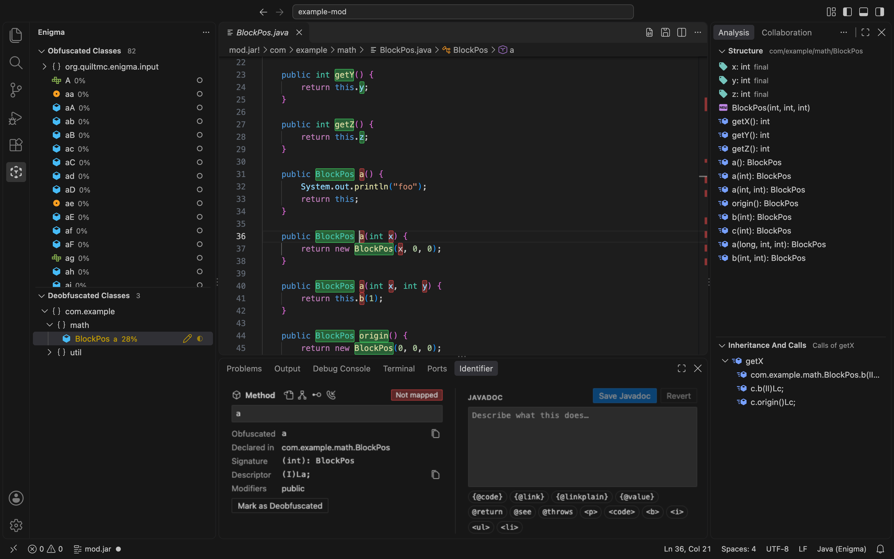

# Enigma for VS Code

[Enigma](https://github.com/QuiltMC/enigma), the tool for deobfuscating Java bytecode, as a VS Code extension.

Unofficial port, not affiliated with the Quilt Project.

## Requirements

Java 17 to 26, which is found automatically: `JAVA_HOME`, then `java` on the `PATH`, then the JDKs installed in the
usual places. To choose another, run **Enigma: Select Java Runtime...** or set `enigma.java.home`.

## Getting started

1. Open a jar: run **Enigma: Open Jar...**, or right-click a `.jar` in the explorer and choose **Open with Enigma**.
2. Open the **Enigma** view in the activity bar. It lists the classes of the jar, obfuscated and deobfuscated apart.
3. Click a class to read it, decompiled.
4. Type over a highlighted name to rename it, and press <kbd>Enter</kbd>.
5. Save the mappings with <kbd>Ctrl</kbd>+<kbd>S</kbd> (<kbd>Cmd</kbd>+<kbd>S</kbd> on macOS). The first time, you are
   asked where, and in which format.

Mappings you already have are opened with **Enigma: Open Mappings...**, or **Open Mappings Folder...** for Enigma's
directory format. A jar opened again comes back with the mappings it was last saved with.

## Renaming

Every name in a decompiled class is highlighted: classes, methods, fields, parameters and local variables. Everything
else is protected, and edits outside a name are undone.

- Type over a name to rename it. Every other use of it in the class follows as you type.
- <kbd>Enter</kbd> or <kbd>Tab</kbd> applies the name, and so does moving the cursor elsewhere or saving.
  <kbd>Escape</kbd> puts the old one back.
- On a name that is still obfuscated, what you type replaces it, like in Enigma.
- A name that cannot be given, such as one already taken, is marked with the reason and stays to be corrected. Moving
  away from it drops it, with a message saying why.
- Renaming a method renames the methods it overrides and that override it, across the jar.

Other ways to rename:

- **Rename Symbol** (<kbd>F2</kbd>) on a name.
- The **Identifier** pane, which shows what is under the cursor: its names, where it is declared, its signature and
  its Javadoc, all editable.
- The class tree: right-click a class or package for **Rename Class...**, **Rename Package...** and **Move Package...**.
- **Mark as Deobfuscated / Reset to Obfuscated** (<kbd>Ctrl</kbd>+<kbd>Alt</kbd>+<kbd>O</kbd>) keeps a name as it is, or
  takes the name given back.

Mapping changes are undone and redone with <kbd>Ctrl</kbd>+<kbd>Z</kbd> and <kbd>Ctrl</kbd>+<kbd>Y</kbd>
(<kbd>Cmd</kbd>+<kbd>Z</kbd> and <kbd>Cmd</kbd>+<kbd>Shift</kbd>+<kbd>Z</kbd> on macOS) in a class.

## Documenting

**Edit Javadoc** (<kbd>Ctrl</kbd>+<kbd>Alt</kbd>+<kbd>D</kbd>) documents what is under the cursor, as does the Javadoc
field of the Identifier pane. The Javadoc is part of the mappings, and shows in the decompiled code.

## Finding your way

- **Go to Definition**, **Find All References**, hover, the outline, and **Go to Symbol in Workspace**
  (<kbd>Ctrl</kbd>+<kbd>T</kbd>) work in decompiled classes.
- **Enigma: Search Classes, Methods and Fields...** (<kbd>Ctrl</kbd>+<kbd>Shift</kbd>+<kbd>Alt</kbd>+<kbd>F</kbd>)
  searches the whole jar by name.
- <kbd>Alt</kbd>+<kbd>Down</kbd> and <kbd>Alt</kbd>+<kbd>Up</kbd> go to the next and previous name that is still
  obfuscated.
- The **Structure** pane lists the members of the class that is open, filtered by whether they are named or documented.
- The **Inheritance and Calls** pane shows what a class extends and what extends it
  (<kbd>Ctrl</kbd>+<kbd>Alt</kbd>+<kbd>I</kbd>), the implementations of a method (<kbd>Ctrl</kbd>+<kbd>Alt</kbd>+<kbd>M</kbd>),
  and who calls it (<kbd>Ctrl</kbd>+<kbd>Alt</kbd>+<kbd>C</kbd>). The editor's own **Show Type Hierarchy** and
  **Show Call Hierarchy** work too.

On macOS, <kbd>Cmd</kbd> takes the place of <kbd>Ctrl</kbd> in all of these.

The panes are where Enigma has them: the class trees on the left, the Identifier pane at the bottom, Structure and
Collaboration on the right. They can be moved like any view.

## Decompilers and bytecode

Classes are decompiled with Vineflower, CFR or Procyon: **Enigma: Select Decompiler...** switches between them.
Vineflower's own options are set in `enigma.vineflower`. **Show Bytecode** opens the bytecode of a class, read-only, and
**Decompile Class Again** starts over when a class looks wrong.

## Mappings

| Format                              | Opens | Saves |
| ----------------------------------- | ----- | ----- |
| Enigma (a file, a folder, or a zip) | yes   | yes   |
| Tiny v2                             | yes   | yes   |
| SRG / TSRG                          |       | yes   |
| ProGuard                            | yes   |       |

- **Save Mappings As...** saves in another format or place. `enigma.autoSaveMappings` saves after every change.
- **Drop Invalid Mappings** removes mappings of what is not in the jar.
- **Reload Mappings** reads them again from disk, and **Reload Jar and Mappings** both.
- **Mapping Statistics** shows how much of the jar is named, by package, and **Show Mapping Progress in Class Trees**
  shows it next to every class.
- **Export Decompiled Source...** writes the classes with their names as `.java` files, and **Export Remapped Jar...**
  a jar with the names given.

## Working together

**Enigma: Collaborate...** opens the Collaboration pane, to host a session for others to join, or to join one, with
Enigma itself or with VS Code. Everyone sees the names the others give as they give them, and can chat. **Start
Dedicated Server in Terminal...** runs Enigma's server for the jar on its own.

## AI assistants

Assistants can read the jar and name things with the same tools as you: in VS Code's chat in agent mode, and, for
assistants outside the editor such as Claude Code, over the Model Context Protocol. For those, turn on
`enigma.mcp.enabled` and run **Enigma: Connect an Assistant over MCP...**: it copies the command that adds Enigma to
Claude Code, or the configuration for another assistant, with the address and token it connects with. Everything they change can be undone like your own changes.

## Settings

The most useful ones; all are under **Enigma** in the settings.

| Setting                                | What it does                                                                              |
| -------------------------------------- | ----------------------------------------------------------------------------------------- |
| `enigma.java.home`                     | The Java runtime that runs Enigma, when the one found is not the one you want.            |
| `enigma.java.vmArgs`                   | Arguments for it, such as `-Xmx4G` for very large jars.                                   |
| `enigma.libraries`                     | Jars the opened jar depends on, for better decompiling. They are not shown or mapped.     |
| `enigma.decompiler`                    | Vineflower, CFR or Procyon.                                                               |
| `enigma.autoSaveMappings`              | Save the mappings after every change.                                                     |
| `enigma.reopenLastProject`             | Whether a window opens the jar and mappings it had last time.                             |
| `enigma.editor.inlineRename`           | Turn off to keep classes read-only, and rename with <kbd>F2</kbd> or the Identifier pane. |
| `enigma.editor.replaceObfuscatedNames` | Turn off to edit obfuscated names like any other, instead of replacing them.              |
| `enigma.classTree.mode`                | Obfuscated and deobfuscated classes in two trees, or all in one.                          |
| `enigma.profile`, `enigma.pluginJars`  | An Enigma profile and Enigma plugins, as in Enigma.                                       |

## Problems

**Enigma: Show Log** shows what the engine did, and **Enigma: Restart Engine** starts it again, keeping the project and
what was not saved. Report issues at <https://github.com/Dani-error/enigma-vscode/issues>.

## License

[LGPL-3.0-or-later](LICENSE). See [THIRD_PARTY_NOTICES.md](THIRD_PARTY_NOTICES.md) for the bundled libraries.
